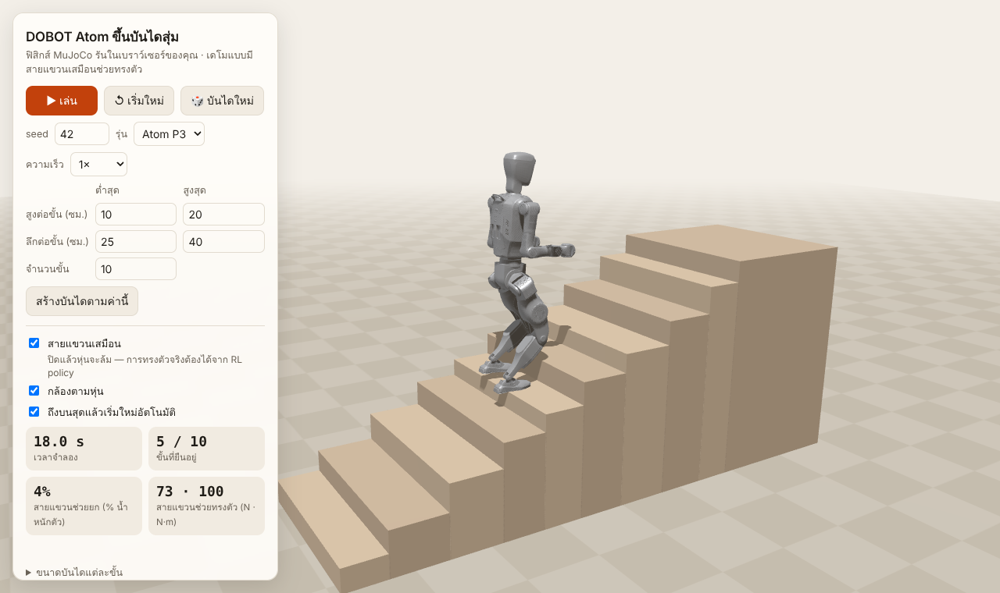

# Atom Stairs Climb

หุ่น humanoid **DOBOT Atom** ก้าวขึ้นบันไดสุ่ม 10 ขั้น (สูงและลึกไม่เท่ากัน) จำลองด้วย **MuJoCo** รันในเบราว์เซอร์ได้เลย ไม่ต้องติดตั้งอะไร

*DOBOT Atom humanoid climbing a random 10-step staircase (uneven rise and depth), simulated with MuJoCo and running entirely in your browser.*

**▶ ลองเล่น:** `https://<your-username>.github.io/atom-stairs-climb/`



## สิ่งที่ทำได้ในหน้าเว็บ

- สุ่มบันไดใหม่ด้วยเลข seed หรือกำหนดช่วงความสูง ความลึก และจำนวนขั้นเอง
- เลือกหุ่นรุ่น P3 หรือ P2 และปรับความเร็วการเล่น (0.25×–2×)
- เปิด/ปิด **สายแขวนเสมือน** ระหว่างที่หุ่นกำลังเดิน ปิดเมื่อไรหุ่นจะล้มทันที
- ดูค่าแบบ real-time: ขั้นที่ยืนอยู่ และแรงที่สายแขวนช่วย
- หมุนกล้องด้วยเมาส์หรือนิ้ว และเปิดโหมดกล้องตามหุ่นได้

## ⚠ นี่คือเดโมแบบมีตัวช่วย

- **วางแผนเท้า:** ใช้ขนาดบันไดที่รู้ล่วงหน้า ยังไม่ได้ใช้กล้อง แล้วคำนวณมุมข้อต่อด้วย Inverse Kinematics
- **มอเตอร์ขา:** ไล่ตามแผนและรับน้ำหนักตัวเอง สายแขวนช่วยยกตัวเฉลี่ยเพียงราว 4–5%
- **สายแขวนเสมือน:** ช่วย**ทรงตัว** (ดันประคองราว 80 N และแรงบิดตั้งลำตัวราว 100 N·m) เหมือนสายกันล้มในห้องแล็บ
- **การทรงตัวจริง:** ต้องได้จาก Reinforcement Learning policy ซึ่งเทรนได้ด้วย repo ของ DOBOT

## โครงสร้าง

```
index.html          หน้าเว็บ
js/sim.js           ฟิสิกส์และตัวควบคุม (วางแผนก้าว, IK, สายแขวน)
js/main.js          ภาพ 3D (three.js) และปุ่มควบคุม
lib/                MuJoCo WebAssembly 3.17.0 (Apache-2.0) และ three.js r170 (MIT)
python/             เวอร์ชัน Python สำหรับรันบนเครื่อง
```

**โมเดลหุ่นไม่ได้เก็บไว้ใน repo นี้** หน้าเว็บโหลดตรงจาก
[embodied-dobot/atom-locomotion-training](https://github.com/embodied-dobot/atom-locomotion-training)
ทุกครั้งที่เปิด (ประมาณ 26 MB สำหรับรุ่น P3) ถ้าโหลดไม่ได้ หน้าเว็บจะให้เลือกโฟลเดอร์ `resources/robots/ATOM` จากเครื่องแทน

## เปิดใช้ GitHub Pages

1. อัปโหลดไฟล์ทั้งหมดใน repo (คง `js/`, `lib/` และ `python/` ไว้เป็นโฟลเดอร์)
2. ไปที่ **Settings → Pages** แล้วตั้ง **Source: Deploy from a branch**, **Branch: main**, **Folder: / (root)** แล้วกด **Save**
3. รอ 1–2 นาที ลิงก์จะขึ้นด้านบนของหน้า Pages

## ลองบนเครื่องตัวเอง

เปิดไฟล์ `index.html` ด้วยการดับเบิลคลิก**ไม่ได้** เพราะเบราว์เซอร์ไม่ยอมโหลดไฟล์ WebAssembly จากไฟล์ในเครื่องตรง ๆ ต้องเปิดผ่านเว็บเซิร์ฟเวอร์จำลองแทน
```bash
python -m http.server 8000
```
แล้วเปิด <http://localhost:8000>

## เวอร์ชัน Python (โฟลเดอร์ `python/`)

```bash
pip install -r python/requirements.txt
git clone https://github.com/embodied-dobot/atom-locomotion-training.git
python python/atom_stairs_climb.py --repo ./atom-locomotion-training --seed 42
```
มี `atom_stand_demo.py` (ยืน/ย่อเข่า) และ `atom_stairs_demo.py` (สร้างฉากบันได) ด้วย
บน Windows ARM ต้องใช้ Python รุ่น x64 เพราะ MuJoCo ยังไม่มีเวอร์ชัน ARM64

## เครดิต

- โมเดลหุ่น mesh และค่า PD gains: [DOBOT ATOM Learning](https://github.com/embodied-dobot/atom-locomotion-training)
- ฟิสิกส์: [MuJoCo](https://mujoco.org) โดย Google DeepMind (Apache-2.0, ดู `lib/LICENSE-mujoco.txt`)
- กราฟิก 3D: [three.js](https://threejs.org) (MIT, ดู `lib/LICENSE-three.txt`)
